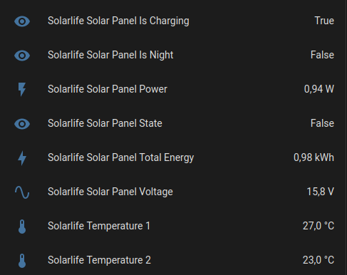

# Solarlife MPPT BLE Client

This Python application connects to an X45, 10 A, MPPT solar charge controller via Bluetooth Low Energy (BLE). It reads the data from the charge controller and publishes it to Home Assistant using MQTT.

The application establishes a connection to the MQTT broker and the BLE device, retrieves the details from the charge controller periodically, and publishes the data to MQTT topics. Home Assistant can then subscribe to these topics to display the data in its user interface.



## Requirements

- Python 3.12+
- [Bleak](https://github.com/hbldh/bleak) - A BLE library for Python
- [aiomqtt](https://github.com/sbtinstruments/aiomqtt) - A MQTT library for Python

## Installation

1. Clone the repository:

   ```bash
   git clone https://github.com/subDesTagesMitExtraKaese/solarlife-mppt-ble-client.git
   ```

2. Change into the project directory:

   ```bash
   cd solarlife-mppt-ble-client
   ```

3. Install the required Python packages using pip:

   ```bash
   python -m venv venv
   source venv/bin/activate
   pip install -r requirements.txt
   ```

## Usage

1. Run the application by providing the required command-line arguments:

   ```bash
   python main.py <BLE device address> --host <MQTT broker host> --port <MQTT broker port> --username <MQTT username> --password <MQTT password>
   ```

   Replace `<BLE device address>` with the Bluetooth address of your MPPT solar charge controller. The other arguments are optional and can be used to customize the MQTT connection.

2. The application will connect to the MQTT broker and the BLE device. It will periodically retrieve the data from the charge controller and publish it to MQTT topics.

3. Home Assistant can subscribe to the MQTT topics to display the published data in its user interface.

## MQTT Topics

The application publishes MQTT Discovery entries and state topics using this
layout:

- Configuration: `homeassistant/<platform>/solarlife/<key>/config`
- State: `homeassistant/<platform>/solarlife/<key>/state`
- Command, for writable values: `homeassistant/<platform>/solarlife/<key>/command`

`<platform>` is selected from the register format. `<key>` is the register name
from [`registers.toml`](registers.toml), for example `battery_percentage` or
`battery_voltage`.

## Home Assistant Integration

To integrate the published data into Home Assistant, you have to enable the mqtt platform. The device is discovered automatically.

Here's an example configuration in Home Assistant's `configuration.yaml` file:

```yaml
mqtt: {}
```

## Contributing

Contributions are welcome! If you encounter any issues or have suggestions for improvements, please open an issue or submit a pull request.

## License

This project is licensed under the [MIT License](LICENSE).